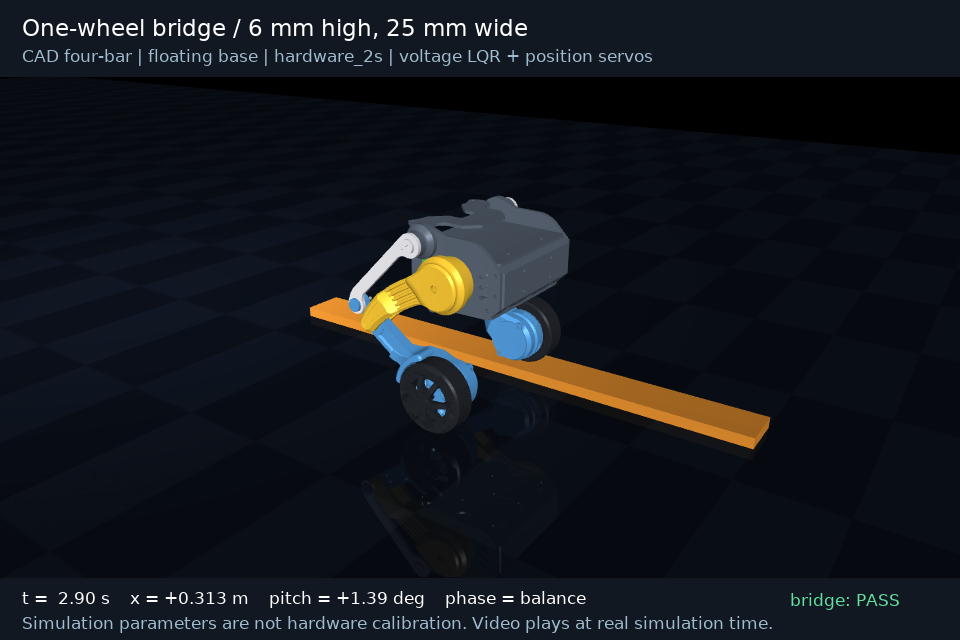

# 世博轮足平衡车在mujoco中仿真实现

基于真实 STEP 装配体的四连杆轮腿模型，提供自由基座平衡、前后移动、单侧桥、台阶和微跳的可复现实验。控制使用轮电压 LQR、位置舵机高度/横滚协调及接触驱动跳跃监督器，适配原硬件的执行器类型。

这是用于后续研究的仿真基线。质量分布、电机与舵机动力学尚未完成当前实物标定；现阶段不声称达到 RAL 论文要求或可直接部署实机。



## 快速运行

Python 3.10+，推荐使用已激活的 ROS 2 Python 环境。纯 MuJoCo 实验不依赖 ROS。首次安装下载约 37 MB 的固定版本模型资产，并逐文件校验 SHA-256：

```bash
bash scripts/setup.sh
.venv/bin/wheellegged run all --output outputs/my-baseline --video
.venv/bin/python -m pytest -q
```

若默认 Python 缺少 `venv`/`pip`，先安装对应系统包，或指定具有完整环境的解释器：

```bash
WHEELLEGGED_PYTHON=/path/to/ros-compatible/python bash scripts/setup.sh
```

`setup.sh` 创建项目内 `.venv`，不会修改已有 ROS 环境。运行结果按任务存放：`metrics.json`、每个物理步的 `trace.npz`、`trajectory.png`，以及选择 `--video` 后生成的 `simulation.mp4`。已有实验目录拒绝覆盖，重跑请换输出目录。无显示器时视频采用 EGL；需要可用的 OpenGL/EGL 驱动。

交互窗口：

```bash
.venv/bin/wheellegged view --terrain flat
.venv/bin/wheellegged view --scenario bridge --auto
```

采用游戏式 **WASD按住控制、松开停车**：`W`前进、`S`后退（±0.12m/s），`A`左转、`D`右转（±0.4rad/s），可组合按键。释放运动键后相应目标归零，由平衡控制器减速；窗口失焦会清除按键，避免持续运动。`X`停车、`J`单次跳跃；`1–5`切换五个自动演示，`M`切换手动/自动，`R`重置，`P`暂停，`F`切换跟随视角。窗口显示目标与实测速度、姿态、轮接触和执行器状态。物理步长固定0.5ms，画面约60Hz刷新，完整操作见[可视化说明](docs/visualization.md)。核心指令边界为速度±0.3m/s、偏航率±1rad/s，不表示边界内任意复合动作均已验证。

左右腿可以单独调整：按住 `Q/Z` 伸长/缩短左腿，`E/C` 伸长/缩短右腿；松开保持当前高度，`T/G` 同时伸长/缩短双腿，`H` 恢复双腿默认高度。平地左右腿不等长时，机身会形成相应的横滚姿态。`J` 请求站立跳跃并清除运动键；尚在快速移动或姿态不满足条件时会明确拒绝，停稳后重新按 `J`。跳跃期间双腿由状态机接管，落地回稳后恢复此前设定的左右高度。

硬件JSON修改后请重启仿真进程，使新配置生效。

默认 `--profile hardware_2s` 使用用户确认的2S标称7.4V、电机/舵机规格约束及修正组件质量。`--profile reference` 保留旧参考参数用于对照。来源、换算及待测项见[硬件参数](docs/hardware_parameters.md)和[质量审计](docs/hardware_mass_audit.md)。

## 已定义的实验

| 任务 | 明确条件 | 验收依据 |
|---|---|---|
| 平衡 | 额外 ±0.05 rad 初始俯仰扰动 | 自由基座恢复，尾窗位置/速度/姿态门槛 |
| 前后移动 | +0.12 与 −0.12 m/s 指令 | 两个方向实际位移、速度误差、停车恢复 |
| 台阶 | 6 mm 直角台阶；提前伸腿至 −0.30 rad；接近速度 0.18 m/s | 双轮到达并停在台面，禁止下腿辅助支撑 |
| 单侧桥 | 左轮走 6 mm 高、25 mm 宽、300 mm 长桥，右轮走地面；0.25 m/s | 完整中央桥段的两侧实际接触、轮高和轨迹，不得绕桥 |
| 微跳 | 固定 0.1471 N·m 舵机上限；蹲下、推蹬、收腿、接触确认落地 | 双轮无接触且净空超过 1 mm 持续至少 20 ms，随后落地回稳 |

最终数值和已知失败边界见 [验证记录](docs/VALIDATION.md)。输入轨迹公开在 `evaluate.py`，所有成功标准独立于控制器的相位标签。视频回放已保存的物理状态，不参与控制或评分。

## 控制与模型

- 156 个 CAD 可视零件、左右四杆闭环、浮动机身；轮半径 18.5 mm、轮距 87.3 mm。
- 默认两轮q轴电压控制范围 ±3.7 V，与2S母线下SinePWM及配套反电动势近似一致；两腿位置伺服力矩范围 ±0.14709975 N·m。没有锁机身、位姿驱动移动、外加跳跃升力或瞬时速度重置。
- 用实际 MuJoCo 质量矩阵建立无滑滚动的局部倒立摆近似，解离散 LQR；七个腿姿态插值增益，计入反电动势和关节阻尼。完整仿真保留被动闭链与接触。
- 左右高度可分别指定，四杆几何差决定横滚目标；反馈修正其误差，使用剩余髋行程并限制调整速率。默认等高目标继续自动调平。
- 跳跃由持续离地/持续接地确认驱动，带起跳前守门及超时恢复。轮净空与质心跳高分开记录。
- 默认物理/控制周期 0.5 ms；ROS 发布 100 Hz。1 ms 曾出现可见的输入数值抖动，因此单独保留步长对照。

原固件腿部是位置舵机，不能照搬另一个 2.2 kg 机器人使用的直接力矩 VMC。这里采用与硬件模式相符的位置协调；没有把位置命令冒称为已标定的足端力控制。推导、符号和数值审查见 [控制审查](docs/control_design_review.md)，机械来源及假设见 [模型说明](docs/model_provenance.md)。

## ROS 2

```bash
bash scripts/ros2_run.sh --ros-args -p use_sim_time:=true -p terrain:=flat
bash scripts/ros2_run.sh --ros-args -p use_sim_time:=true -p viewer:=true
```

另一个已激活 ROS 2 环境的终端：

```bash
ros2 topic pub --rate 10 /cmd_vel geometry_msgs/msg/Twist '{linear: {x: 0.05}}'
ros2 topic pub --once /jump std_msgs/msg/Empty '{}'
ros2 topic pub --once /leg_command sensor_msgs/msg/JointState '{name: [L_hip, R_hip], position: [-0.24, -0.20]}'
```

发布 `/clock`、`/joint_states`、`/imu`、`/odom`、TF；0.5 s 未更新速度命令后目标归零。ROS 消息输入直接复用同一物理控制核心。构建、启动和真实 DDS 测试见 [ROS 说明](ros2/README.md)。

## 研究边界

当前控制使用 MuJoCo 真值状态，尚未建立含噪声、延迟和打滑的硬件状态估计器。IMU/编码器已在模型与 ROS 接口中提供，但不能据此声称完整硬件状态估计迁移已经完成。旧参考质量0.336 kg来自另一复刻样机；当前按每个YT2208为41g、STS3032为20.6g逐组件修正，得到估计总质量0.31765 kg，使用精确STEP体积分同步更新COM和惯量。其余组件与电池仍是参考估计；整机称量、转子/定子质量比例、轮电机映射、伺服响应和接触摩擦尚待实测。

这些任务对应微型机器人尺度，6 mm 台阶不是普通建筑台阶，轮净空不是质心跳高。尚未验证任意尺寸桥梁、任意速度上阶、连续多级楼梯、复杂地形跳跃和实机泛化。提高尺寸或改变执行器能力后必须重跑验收，不能沿用已有 PASS。

面向论文的对照、消融、随机化、重复实验和实机标定计划见 [研究计划](docs/research_plan.md)。额外加速度计优化按原要求留到后阶段。

## 代码与来源

```text
src/wheellegged/       模型、观测、LQR、控制、跳跃、评价和渲染
ros2/wheellegged_ros/  ROS 2 薄适配包
scripts/              固定资产下载、环境、独立动力学和 DDS 检查
tests/                几何、状态、控制边界和真实物理任务测试
docs/evidence/        小型可追溯验证记录
outputs/              本地完整轨迹与视频（不进入 Git）
assets/cad/           固定版本第三方资产缓存（不进入 Git）
```

原始机械与硬件：[MuShibo/Micro-Wheeled_leg-Robot](https://github.com/MuShibo/Micro-Wheeled_leg-Robot)。CAD→MJCF 模型：[dycsrl/Micro-Wheeled_leg-Robot-Model](https://github.com/dycsrl/Micro-Wheeled_leg-Robot-Model)。控制架构参考：[Edmounds/wheel_legged_robot_sim](https://github.com/Edmounds/wheel_legged_robot_sim)。补充四个相似项目的控制、可视化、执行器与许可比较见[额外开源项目调查](docs/additional_projects.md)。逐项差异、固定提交和授权边界见 [参考审计](docs/reference_review.md) 与 [第三方声明](THIRD_PARTY_NOTICES.md)。

本项目新增代码使用 MIT；该许可不覆盖下载的第三方 CAD/网格、硬件或固件。官方 MuJoCo skills 的安装位置、提交与校验记录见 [安装记录](docs/mujoco_skill_status.md)。
