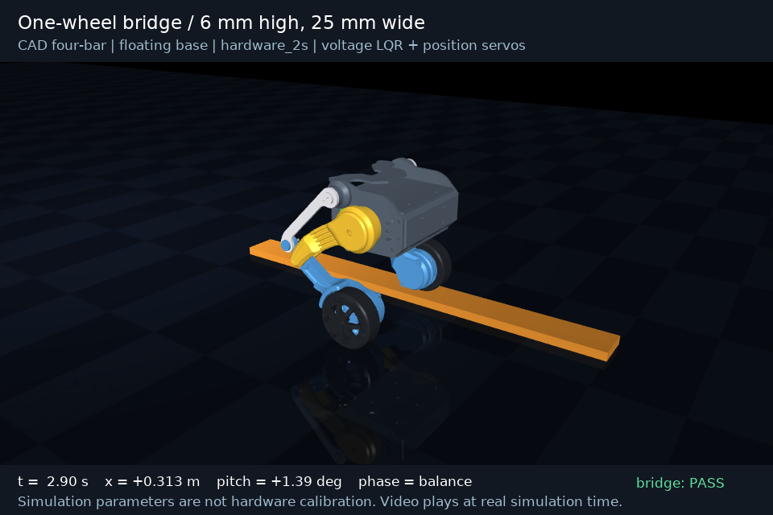
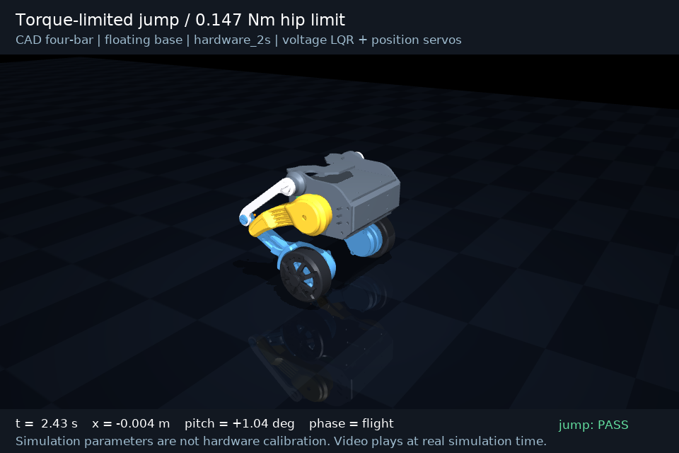

# 本地验证记录

## hardware_2s v1（2026-11-20）

默认配置基于用户确认的2S标称7.4V、YT2208/STS3032规格及精确STEP质量修正，估计总质量0.317649381kg。轮q轴电压限±3.7V；髋额定限矩±0.14709975Nm。电压-转矩增益、伺服响应、其余组件质量及摩擦尚未实测标定，见[硬件参数](hardware_parameters.md)与[质量审计](hardware_mass_audit.md)。

环境：MuJoCo3.17.0、Python3.14.10、NumPy2.5.5，物理/控制步长0.5ms。模型保留自由基座、双侧四杆闭链、四执行器及真实接触；没有锁机身、外加升力、位姿移动或起跳速度脉冲。

```bash
.venv/bin/wheellegged run all --profile hardware_2s --output outputs/validated-hardware-v1 --video
.venv/bin/python -m pytest -q
.venv/bin/python scripts/check_dynamics.py
```

已有输出目录拒绝覆盖，复跑应换目录。小型结果在[hardware_v1](evidence/hardware_v1/)，本地完整每步NPZ、曲线、单任务视频及41秒合集在`outputs/validated-hardware-v1/`。记录包含源码、硬件配置及运行时XML的SHA-256；`git_commit`是运行时HEAD基础提交，该批运行包含工作区修改，具体执行源码以哈希为准。

| 任务 | 结果 | 实测指标 |
|---|---|---|
| 平衡，额外+0.05rad初始俯仰 | PASS | 最终位移2.541mm，末1秒速度峰值1.108×10⁻⁶m/s |
| 前后移动，指令±0.12m/s | PASS | 前/后速度RMSE为0.02045/0.02592m/s；实际位移+0.339/−0.374m |
| 6mm直角台阶 | PASS | 预伸腿−0.30rad、接近0.18m/s；双轮台面支撑5.0845s，最终轮轴x=0.539m |
| 左轮6mm高、25mm宽单边桥 | PASS | 0.25m/s指令；整个中央桥段支撑成立，连续不等高支撑0.878s，横滚峰值0.01151rad |
| 平地微跳 | PASS | 双轮净空>1mm且无力持续59.5ms；双轮最小净空峰值6.985mm，落地后回稳 |

五任务全程无非有限状态、求解器警告及非轮辅助支撑；最大闭链残差0.1875mm，指令与执行器力均在配置范围内。加入WASD按住/松开/失焦回归后，完整自动测试**100项通过**，另有两条继承环境的Lark弃用警告；依赖检查无冲突。




## 物理验收与独立检查

一般门槛为全程pitch<0.45rad、roll<0.25rad、闭链误差<1mm；末1秒姿态误差RMS<0.03rad、速度峰值<0.03m/s；非轮地面支撑峰值<0.05N。台阶必须双轮真正到达并停在台面；桥必须左轮全程通过中央桥段、右轮保持地面支撑，随后双轮驶出回到地面。

跳跃要求两轮法向力均<0.02N、真实圆柱最低点净空均>1mm、连续≥20ms。评分独立于控制器相位；伪造`flight`、单帧接触丢失或缩短时长均不能通过回归测试。

[额外五组试验](evidence/hardware_v1/sensitivity.json)全部通过：平衡初始−0.05rad、台阶初始±0.01rad、台阶0.25ms步长、桥0.25ms步长。台阶三项对照没有非轮支撑，横滚峰值约0.00139、0.00100、0.00430rad。这是指定条件下的确定性检查，不是大规模随机试验或统计成功率。

[独立动力学审查](evidence/dynamics_review_hardware_2s.json)：

| 指标 | 0.5ms | 0.25ms |
|---|---:|---:|
| 双轮最小净空峰值 | 6.985mm | 7.302mm |
| 离地后COM继续上升 | 2.878mm | 3.075mm |
| 飞行段拟合竖直加速度 | −9.81187m/s² | −9.81098m/s² |

COM上升仍有约6.8%的步长差异，不能报告完全数值收敛。诊断用较低净空门槛0.1mm/0.05N得到70.5/71.5ms飞行段，与正式验收59.5ms定义不同。轮净空包含收腿贡献，不能称为质心跳高。1ms下平衡轮电压高频标准差约0.192V，明显大于0.5/0.25ms，故不作为默认。推导、虚功映射及线性化检查见[控制审查](control_design_review.md)。

## 可视化与ROS

原生GLFW窗口由MuJoCo渲染，提供WASD按住控制、松键停车、组合键、失焦清零、五场景自动演示、重置/暂停、实时状态和曲线。新[窗口与闭环验收](evidence/viewer_smoke.json)有51项顶层检查全部通过；W+A/W+D各持续3秒后释放，产生约(.266,±.188)m位移与±1.122rad转向，松键不改写qpos/qvel，随后6秒内尾速峰值<0.00021m/s、偏航率<0.0043rad/s。测试采用程序自身的GLFW事件入口注入，不能冒称人工按键验证。ROS节点可用`viewer:=true`显示同一受`/cmd_vel`与`/jump`驱动的仿真。操作与真实窗口检查见[可视化说明](visualization.md)。

ROS新配置的[DDS验收](evidence/ros2_smoke.json)、[普通colcon与无头launch](evidence/ros2_launch.json)、[真实窗口与外部指令](evidence/ros2_viewer_launch.json)均通过。可视化外部指令测试在1秒内移动约2.68cm，并检查仿真子进程正常退出；已修复窗口异步销毁与进程退出的竞争，不能仅拿launch父进程退出码作证。详见[ROS说明](../ros2/README.md)。

里程计速度使用普通body原点及body轴，核心速度使用轮轴原点；已修复误取惯性主轴/质心的问题。独立ROS真值由body原点Jacobian乘qvel再旋转得到，轮轴速度另用积分后位移差分核对。

## 历史与边界

[reference v2历史报告](archive/validation_reference_v2.md)保留旧参数及台阶+0.01rad下腿触阶的失败。仅替换执行器、尚未修正质量时也曾出现桥连续支撑失败，证据在`outputs/hardware_actuator_probe/`。探索结果没有覆盖或改成PASS。

当前不包含实机参数辨识、含噪声/延迟估计、任意地形感知、连续楼梯、多高度跳跃或额外加速度计优化。6mm台阶是微型机器人实验，不能据此宣称普通建筑楼梯能力。当前成果是可复现仿真基线；RAL级结论仍需明确创新、对照消融、不确定性实验及实机证据。
