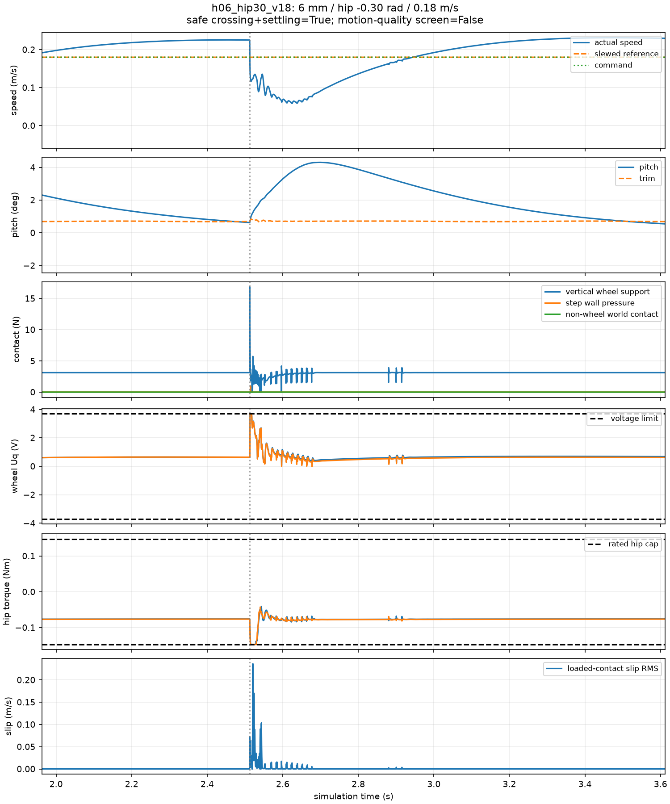

# 台阶诊断：通过与运动质量分开验收

2026-11-20，MuJoCo 3.17.0，`hardware_2s`，固定 0.5 ms 物理/控制周期。本次只新增独立诊断脚本和证据，未修改控制器、模型生成器或已有基线。

**当前 6 mm 台阶确实能通过，但边缘减速明显；现有 PASS 并不表示平顺越障。** 本次 12 个确定性参数组合中，5 个完成安全跨越并停稳，只有 4 mm / 髋角 −0.30 rad / 命令 0.18 m/s 同时通过预设的运动质量筛选。这是参数敏感性结果，不是随机试验成功率，也不是机器人的极限台阶高度。

## 默认案例发生了什么

默认台阶：高 6 mm、前沿 x=0.20 m；轮半径 18.5 mm，因此台阶高为轮半径的 32.4%。髋角命令 −0.30 rad；速度命令在 1–4 s 为 0.18 m/s，其余时间为零。初始化仍为 −0.20 rad，经原控制器限速伸腿，未瞬移关节。

| 实测项 | 默认案例结果 |
|---|---:|
| 首次轮胎—台阶接触 | 2.5125 s，轮轴 x=0.1863305 m |
| 接触前 0.12–0.02 s 平均实际速度 | 0.22551 m/s |
| 边缘区最低速度 | 0.05859 m/s |
| 相对接触前速度下降 | **74.02%** |
| 全程最大绝对 pitch | 4.307° |
| 首次两轮完整位于台面且受支撑 | 2.8380 s |
| 停车命令后持续满足稳态条件的时间 | 2.0145 s |
| 边缘轮电压饱和累计时间 | 4.5 ms |
| 边缘髋执行器力矩饱和累计时间 | 16.0 ms |
| 边缘带载接触点切向滑移 RMS / 单点峰值 | 0.01868 / 0.28174 m/s |
| 非轮胎碰地/碰台阶法向力 | 0 N |

接触前速度本身比 0.18 m/s 命令高约 25.3%，所以不能把命令值当作实际冲阶速度。碰撞发生后同时出现支撑力脉冲、短暂饱和和滑移，随后速度恢复；这是与视频观感对应的实测过程。轮轴到达 x=0.1815 m 只是轮的最前端到达台阶所在平面，此时轮的该部位高于 6 mm 台阶，尚不等于真正碰撞。理想刚性圆轮的角点接触位置为 `x_edge - sqrt(2*r*h-h*h)`，本例约 0.1863618 m，与实测接触位置接近；评分使用实际接触力，不使用该几何近似代替接触。

原 `assess_trace` 已要求姿态、闭环约束、执行器限幅、无机身支撑、两轮到达并留在台面、末段停稳，因此原 PASS 不是单纯“跑够时间”。它没有限制过边缘时的速度损失、短时滑移、冲击或饱和时长，所以会接受这条明显减速的轨迹。独立脚本还额外要求两轮获得**台阶本身**的垂直支撑，不能用地面接触力冒充上台面。



## 12 组小范围敏感性试验

统一从相同平衡初态运行 8 s，在 1–4 s 下发恒定速度，之后停车；除此之外只改表中台阶高度、对称髋角目标和速度。更负的髋角表示伸腿。表中“完成”同时包含安全、真实跨越、末段停稳；所有 12 组都在预设安全界内且无求解器警告，失败主要是未跨过边缘并保持倾斜支撑。滑移使用接触力加权 RMS；它是模型接触点的切向相对速度，不是由轮速简单推算的空转率。

| 台阶 mm | 髋角 rad | 命令 m/s | 完成 | 边缘最低速 m/s | 保留接触前速度 | 滑移 RMS m/s | 最大 pitch ° | 髋饱和 ms | 运动质量 |
|---:|---:|---:|:---:|---:|---:|---:|---:|---:|:---:|
| 6 | −0.20 | 0.10 | 否 | −0.07720 | −67.4% | 0.00497 | 6.576 | 16.0 | 否 |
| 6 | −0.20 | 0.14 | 否 | −0.10740 | −61.9% | 0.01316 | 10.724 | 38.0 | 否 |
| 6 | −0.20 | 0.18 | 是 | 0.02658 | 11.8% | 0.02594 | 6.198 | 20.5 | 否 |
| 6 | −0.20 | 0.22 | 是 | 0.13180 | 49.1% | 0.04491 | 4.297 | 29.0 | 否 |
| 6 | −0.30 | 0.10 | 否 | −0.06633 | −58.4% | 0.03994 | 6.053 | 9.0 | 否 |
| 6 | −0.30 | 0.14 | 否 | −0.10110 | −58.5% | 0.02788 | 10.165 | 23.0 | 否 |
| 6 | −0.30 | 0.18 | 是 | 0.05859 | 26.0% | 0.01868 | 4.307 | 16.0 | 否 |
| 6 | −0.30 | 0.22 | 是 | 0.03978 | 14.8% | 0.33091 | 6.363 | 47.5 | 否 |
| 4 | −0.30 | 0.18 | 是 | 0.12595 | 55.8% | 0.01362 | 3.346 | 12.5 | 是 |
| 8 | −0.30 | 0.14 | 否 | −0.06997 | −40.5% | 0.07045 | 10.213 | 19.5 | 否 |
| 8 | −0.30 | 0.18 | 否 | −0.12529 | −55.6% | 0.10145 | 14.164 | 39.5 | 否 |
| 10 | −0.30 | 0.18 | 否 | −0.06938 | −30.8% | 0.16131 | 14.201 | 45.5 | 否 |

负的“保留速度”表示发生倒退，不是负效率。表内髋饱和时间取边缘区内任意一侧到达额定力矩上限 99% 的累计时间，并非左右两侧时间相加。

可直接支持的判断：

- **仅伸腿不足以低速爬阶。** 6 mm 的 0.10/0.14 m/s 在两种髋角下都失败，最终轮轴 x≈0.186318 m，停在角点；失败过程中已接触并反弹，不能解释为还未开到台阶。
- **在当前 0.18 m/s 命令下，伸腿有帮助。** 从 −0.20 改为 −0.30 rad，最低速度由 0.02658 提高至 0.05859 m/s，最大 pitch 从 6.198° 降至 4.307°；仍没有达到平顺通过。
- **加速不是单调改进。** −0.30 rad 下从 0.18 增至 0.22 m/s，带载滑移 RMS 从 0.01868 升至 0.33091 m/s，电压饱和从 4.5 增至 81.0 ms，最低速度反而下降。不能只依据最终跨越给更快冲阶打高分。
- **阻挡时位置参考继续积累。** 6 mm / 0.14 m/s 的位置参考误差峰值约 0.235 m，8 mm / 0.18 m/s 约 0.357 m。控制器持续积分速度命令的位置参考，与边缘被阻挡后的较大倾角并存。这提示需要接触感知的参考管理；本次未做该项消融，不能宣称它是唯一原因。

这些数据呈现出明显的碰撞/接触切换敏感性，但没有证明“只要增大电机力矩就能解决”。默认案例饱和很短，失败案例也不等同于持续打满执行器。需要把驱动能力、参考管理和腿—轮协调分别做消融。

## 判据与几何一致性

判据在运行前写入 `protocol.json`，未根据 12 组结果回调阈值：

- 安全：`|pitch|<0.45 rad`、`|roll|<0.25 rad`、闭链误差 `<1 mm`、非轮胎世界接触法向力 `<0.05 N`、数值有限、时间递增、8 s 完整运行、无求解器警告及实际控制/力矩不越界。
- 跨越：每轮中心越过实际台阶前沿加自身半径且仍在台面范围内，轮底距实际台面 `<1 mm`，每轮台阶垂直支撑 `>0.1 N`；两轮同时满足持续至少 `0.1 s`。
- 停稳：最后 1 s 两轮始终在台面受支撑，速度峰值 `<0.03 m/s`，相对姿态平衡参考的 pitch RMS `<0.03 rad`。报告的停车收敛时间另要求从该时刻直到结束逐帧满足速度、姿态和支撑条件。
- 运动质量筛选：边缘区速度保留接触前值的至少 50%，倒退不超过 0.02 m/s，带载切向滑移 RMS `<0.03 m/s`，髋额定力矩饱和 `<50 ms`，pitch 相对参考偏差 `<0.08 rad`。边缘区固定为轮轴 x∈[前沿−2r, 前沿+3r] 且仍下发前进命令。这些是**探索性工程筛选阈值**，不是发表标准，也不是原 PASS 条件。

每个案例在 MJCF 中修改台阶高度后重新编译；高度、起止位置、宽度、轮半径均从该案例编译后的 `MjModel` 读取。`_sample` 原有按场景名计算的净空会被本案例实际几何重新计算并覆盖；4/8/10 mm 的成功判定不调用硬编码 6 mm 的旧台阶评分。

接触力来自 `mj_contactForce`；仅统计法向力 `>0.02 N` 的带载接触。切向速度由世界接触点的 `mj_jac` 与真实 `qvel` 相乘，再转入接触坐标系获得；静态地形速度为零。RMS 以法向力加权，峰值另行保留。摩擦使用率只统计平移切向力，未混入扭转摩擦。MuJoCo 接触是柔性约束模型，短暂的接触力与滑移可以共存；这组指标描述仿真现象，不是轮胎实测摩擦定律。[MuJoCo Jacobian 与接触力 API](https://mujoco.readthedocs.io/en/stable/APIreference/APIfunctions.html#mj-jac)、[官方接触模型说明](https://mujoco.readthedocs.io/en/stable/computation/index.html#contact)。

## 复现与证据

在仓库根目录运行，选择不存在或没有诊断记录的新输出目录：

```bash
.venv/bin/python scripts/step_diagnostics.py --workers 2 --output outputs/step-review/reproduction
```

单案例调试：

```bash
.venv/bin/python scripts/step_diagnostics.py --workers 1 \
  --cases h06_hip30_v18 --output outputs/step-review/single-case
```

程序默认另跑一次未修改的 `run_scenario("step")`，与独立脚本默认案例逐点比较，因而完整命令是 **12 个敏感性案例 + 1 个基线等价性检查**。本次 `time/qpos/qvel/ctrl/actuator_force/speed/pitch` 的最大绝对差全部为 **0**，原基线仍 PASS，诊断期间源码哈希未变化。源码、硬件参数、CAD 来源、质量参数及诊断脚本均记录 SHA-256；每个运行模型另存 XML 和其哈希。未用不同 seed 冒充独立重复试验，也未宣称本次检验了 0.25 ms 时间步收敛。

正式结果：`outputs/step-review/matrix-v1/summary.json`；每个案例目录包含 `trace.npz`、`report.json`、实际 `model.xml` 和六面板 `edge_diagnostics.png`。可公开的完整数值摘要另存 [step_diagnostics.json](evidence/step_diagnostics.json)。`probe/` 是脚本开发时的单案例探针，不计入 12 组正式矩阵。

## 对下一阶段的直接约束

先在固定模型内增加可比较的台阶策略基线：接触/阻挡时限制位置参考继续前移，提前规划腿高、车身俯仰与接近速度，再用本矩阵做消融。4 mm 当前案例可作为初始练习地形，6 mm 是显著困难区；8/10 mm 当前失败应保留为失败证据。

学习控制可以从受限残差或接近速度/腿高策略开始，但奖励与终止必须同时约束真实台面支撑、姿态、接触滑移、饱和和停车恢复，不能只有前进位移。训练前仍需校准驱动、舵机及轮胎接触参数；当前这些确定性结果只支持在现有模型里比较，不能直接外推硬件成功率。详细路线由 [learning_control_plan.md](learning_control_plan.md) 统一规划。
