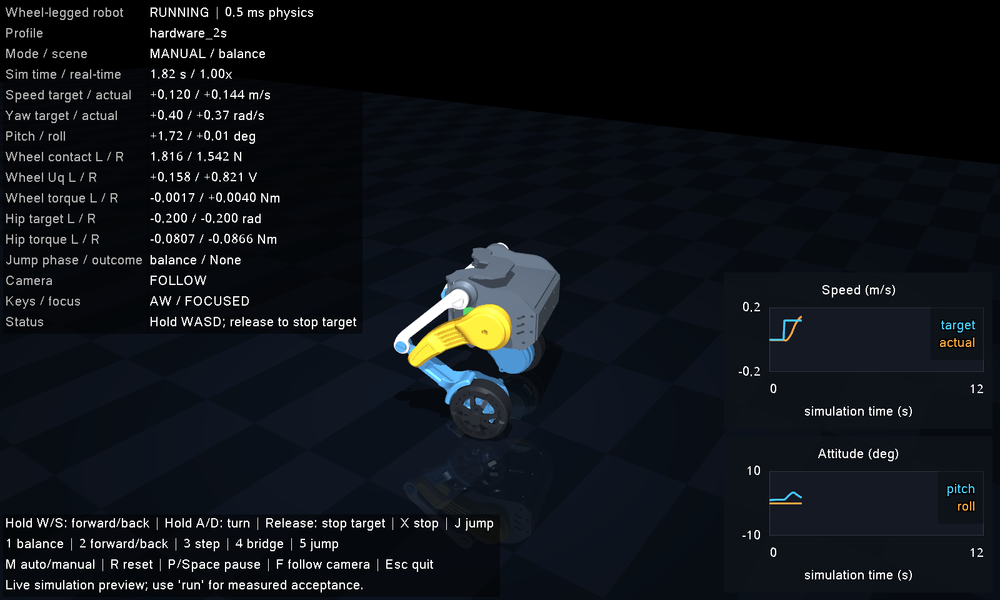

# 原生 MuJoCo 交互可视化

在图形桌面的项目目录运行：

```bash
.venv/bin/python -m wheellegged.cli view
```

默认是 `hardware_2s`、平地、手动命令。初始速度目标为零，平衡控制器已经闭环工作。窗口显示真实 CAD 模型、实时执行器与接触状态，以及速度/姿态曲线；较小窗口会自动隐藏曲线，保留控制状态文本。图形文字使用英文，避免桌面缺少中文字形。



上图由本程序 `mjr_readPixels` 读取渲染帧缓冲，未截取桌面或其他应用；调腿和跳跃按键通过应用注册的回调注入以复现画面。

## 键盘与鼠标

先点击 MuJoCo 窗口使其获得键盘焦点。现在采用游戏式控制：**按住运动，松开相应键就把该轴目标归零**。输入来自本应用 GLFW 窗口的真实按下/释放事件，不依赖系统按键重复，也没有用短时超时猜测松手。

| 键 | 动作 |
|---|---|
| 按住 `W` / `S` | 前进/后退，速度目标为 +0.12 / −0.12 m/s；松开归零 |
| 按住 `A` / `D` | 左转/右转，偏航速度目标为 +0.4 / −0.4 rad/s；松开归零 |
| 按住 `Q` / `Z` | 左腿伸长抬高/缩短降低，松开后保持高度请求 |
| 按住 `E` / `C` | 右腿伸长抬高/缩短降低，松开后保持高度请求 |
| 按住 `T` / `G` | 同时抬高/降低两侧，松开后保持 |
| `H` | 两侧请求回到默认 −0.20 rad；跳跃或暂停期间忽略 |
| `X` | 速度与偏航目标归零，并清空按键状态；重新松开、按下运动键才继续驾驶 |
| `J` | 清除运动和高度按键、取消移动目标，再发出一次站立跳跃请求；保留跳跃前的左右高度请求 |
| `P` 或空格 | 暂停/继续物理积分，并清空手动运动键；暂停期间释放事件和相机仍可处理 |
| `R` | 重置当前场景的姿态、时间、控制器参考和曲线历史，保持当前模式及暂停状态 |
| `M` | 自动/手动切换；进入自动时从初始姿态重播，进入手动时速度和偏航目标归零 |
| `F` | 跟随/自由相机切换 |
| `1` | 自动平衡扰动恢复演示 |
| `2` | 自动前进、停止、后退、停止演示 |
| `3` | 自动 6 mm 台阶演示 |
| `4` | 自动 6 mm 高、25 mm 宽的单侧桥面演示 |
| `5` | 自动平地微跳演示 |
| `Esc` 或关闭窗口 | 退出 |

`W+A`、`W+D` 等组合可同时移动与转向；释放 `W` 而仍按住 `A` 时，只取消前进目标，左转目标保留。同轴反向键同时按住会相互抵消，例如 `W+S` 的纵向目标为零。手动移动键会退出自动模式，由当前真正按住的运动键接管；`J` 也退出自动模式，但先清空运动键与移动目标。`J` 只在首次按下时产生一次请求，保持按住和系统重复事件都不会连续跳跃。

高度键也会切到手动模式。左右髋角请求按 **0.10 rad/s**、每个 0.5 ms 物理步逐步调整，范围为 **−0.30～0 rad**；角度更负表示腿伸长，抬高该侧机身。两侧可以独立或同时调节，同侧相反键抵消，共向重叠不会把速率加倍。松开高度键会保持最后请求，随后仍由限速、限矩伺服跟踪；`H` 只改两侧目标，不会瞬移关节。

跳跃从 `crouch` 到恢复结束期间锁定高度编辑；期间按下的高度键和 `H` 会被忽略，不排队。跳跃前的左右请求保持不变，监督器执行对称推蹬与落地动作，恢复平衡后重新跟随原请求。重新调节需要再次按下高度键。因按下 `J` 只清零运动目标，实际速度可能尚未降下来，移动中请求可能被 `posture_or_speed` 准备条件拒绝；请站稳后重新按 `J`，程序不会偷偷等待后自动重试。

右上角分别显示 `Jump request`（ACCEPTED 或 REJECTED 及原因）、`Jump phase` 和 `Jump outcome`。接受请求、执行阶段和真实腾空是不同证据；是否实际离地仍由接触和轮净空检验判断。

释放事件在下一次窗口事件处理时、下一批物理积分前更新目标；实际车速仍按原控制器的加速度限制逐步收敛，**不会直接改写 qvel 或瞬间刹停**。`X` 也不冻结机器人，不会在已经离地时取消物理运动。跳跃请求没有获得准备条件时可能被监督器拒绝，界面保留其 phase/outcome，不把命令发出当作跳跃成功。

窗口失焦会清空所有按键、将运动目标归零，停止高度调整并保留已有高度请求，同时退出自动演示。重新获得焦点不会恢复旧运动命令，需要再次按键。重置、模式切换、暂停/恢复后也清空手动按键，避免保留不可见的运动状态。

鼠标左键拖动旋转、右键拖动平移、滚轮缩放；右键平移会自动取消跟随，也可以用 `F` 切换。按住 Shift 可切换拖动方向；跟随模式只更新视线中心，不锁定鼠标选择的视角和距离。

`1`–`5` 在同一窗口中重新加载场景模型并清空旧按键，这是显式的新试验初始条件；窗口和按下/释放回调保持存在。`R` 和 `M` 也在原窗口重置。自动演示结束后保持零移动目标继续闭环，不自动瞬移回起点；按 `R` 再次播放。演示是否完成验收仍由独立的 `run` 结果决定。

本入口由自己的窗口管理控制键，直接调用 MuJoCo 公共 `mjv`/`mjr` 渲染 API，不再经过只有整数按键回调的 passive viewer 输入层，因此不会触发 MuJoCo 自带的同名显示快捷键。GLFW 的窗口回调明确区分 `PRESS`、`RELEASE`、`REPEAT`；本程序维护按住集合并忽略 `REPEAT`。[GLFW 输入说明](https://www.glfw.org/docs/latest/input_guide.html#input_key)、[MuJoCo 可视化 API](https://mujoco.readthedocs.io/en/stable/programming/visualization.html)

## 直接选择自动演示与有界 smoke

```bash
# 启动前进/后退自动演示
.venv/bin/python -m wheellegged.cli view --scenario move --auto

# 指定地形，手动驾驶
.venv/bin/python -m wheellegged.cli view --terrain bridge

# 自动台阶演示，墙钟 10 秒后退出，包括暂停时间
.venv/bin/python -m wheellegged.cli view --scenario step --auto --duration 10

# 显式查看历史执行器配置
.venv/bin/python -m wheellegged.cli view --profile reference
```

`--scenario` 选择相应地形；自动播放仍由 `--auto` 决定。没有 `--scenario` 时，`--terrain step/bridge` 对应同名演示，平地对应 balance。`--duration` 是包含模型初始化、窗口打开与暂停在内的墙钟时限，不是仿真时间，因此适合不会无限等待的窗口 smoke。不设置它时会一直运行到用户关闭窗口。该入口只需现有 MuJoCo 和其 GLFW 依赖，无需额外 Studio GUI 包。

代码接口：

```python
from wheellegged.viewer import run_viewer

summary = run_viewer(
    terrain="flat",
    profile="hardware_2s",
    scenario="jump",
    automatic=True,
    duration=10.0,       # None 表示等待用户关闭
    render_hz=60.0,
)
```

返回值包含退出原因、墙钟时间、物理步数、渲染帧数、所选场景/profile、按下/释放/失焦事件与最后状态。这些是 UI 运行诊断，不替代轨迹验收报告。ROS 仍复用保留的 `native_viewer` passive 显示辅助函数，由 ROS 节点自己的物理循环和命令话题控制；这里的 WASD 不用于接管 ROS 节点，避免两个控制入口同时写执行器。

## 状态面板与时序

左上角显示模式和场景、时间与实时时间倍率、目标/实际速度和偏航角速度、pitch/roll、左右轮接触力、轮 Uq/转矩、相机及当前按键/焦点状态。右上角独立显示左右髋角请求、实际髋角、控制器最终伺服目标、请求/实际腿高度、髋转矩及跳跃请求/阶段/结果。腿高度是按四连杆几何与髋角换算的机身局部髋到轮轴竖直距离，不是轮胎离地净空；滚转控制和跳跃监督会使最终伺服目标与用户请求暂时不同。

接触压力与控制器使用同一传感器来源，是轮与世界接触的法向压力总量；包含侧壁接触时不能单独据此宣称已经竖直支撑在台阶上。

物理和控制固定每 **500 µs** 更新，使用与评估相同的 `BalanceController`。自动命令直接复用 `evaluate.scenario_command`，不会另写一套时间表。每帧批量执行所需物理步，只在约 60 Hz 时同步渲染、更新文本和曲线；没有每个物理步都同步窗口或 sleep。

慢机器最多积累 50 ms 墙钟追赶任务，超出时放慢仿真显示，不跳过动力学状态，不扩大时间步长，也不为追求帧率改变控制周期。实时时间倍率会显示性能下降。键盘/失焦回调只入队，事件在积分前处理；窗口、物理、相机和 OpenGL 均由同一个线程拥有。退出时在当前 OpenGL 上下文中释放 MuJoCo 资源，再销毁窗口和 GLFW，不留下后台渲染线程。

控制依然使用 MuJoCo 真值观察；曲线不是加入噪声后的实机传感器估计。用户通过鼠标/键盘主动操作、暂停或重置的交互运行也不自动写为可复现论文实验。正式实验仍使用 `run` 的不可覆盖输出目录、参数哈希与验收检查。

## 本地验证范围

本机已真实打开 GLFW/MuJoCo 窗口，并检查 CAD、文本与两张曲线的渲染。自动有界 smoke 验证固定步长、真实渲染、超时退出和窗口资源清理。交互回归在真实窗口运行时，从代码层调用本应用注册的 GLFW 按下/释放/失焦回调，覆盖不依赖重复事件的长按、组合键、释放、失焦、独立腿高度及释放保持、单次跳跃与高度冻结、暂停、重置和场景切换；**回调注入不等于人工按键验证**。

具体版本、回调覆盖、返回值和检查结果记录在 [viewer_smoke.json](evidence/viewer_smoke.json)。无图形桌面的 CI 应运行模型/控制评估；原生 viewer 需要可用的显示服务器。不要把离屏视频渲染成功当作原生窗口测试成功。

在有图形桌面的环境复现同一组集成检查：

```bash
.venv/bin/python scripts/viewer_smoke.py --output outputs/viewer_smoke.json
```

脚本运行有界自动窗口、回调集成窗口及真实动力学组合转弯/停车检查，完成后自动退出。无需手动按键，也不会向操作系统发送键盘事件；请让测试独立完成，避免人工关闭窗口或额外输入影响预定事件序列。输出路径可自选，默认写入 `outputs/viewer_smoke.json`，不会默认覆盖仓库内已保存的证据。报告记录 viewer 与探针脚本的 SHA-256、环境、每项检查、事件序列和状态快照；进程退出码 0 表示通过，1 表示失败。

报告逐项记录顶层检查，其中单次 `W PRESS` 在没有任何 `REPEAT` 的情况下持续保持超过 1 秒，随后 `RELEASE` 在下一帧把目标归零；高度键则在释放后保持请求。五种场景在同一个窗口中切换；有界自动窗口和交互窗口正常销毁，不遗留线程。另有独立的无 GUI 输入回归：

```bash
.venv/bin/python -m pytest tests/test_viewer_input.py -q
```

组合运动另外使用真正的 MuJoCo 闭环验证：先平衡 1 秒，再持续按住组合键 3 秒，释放后继续积分 6 秒。以下是默认 `hardware_2s` 的结果，尾速统计最后 1 秒：

| 输入 | 运动阶段位移 (x, y)，m | 偏航变化 rad | 释放时实速 m/s | 停车尾段实速峰值 m/s |
|---|---:|---:|---:|---:|
| `W+A` | (+0.266084, +0.187763) | +1.121228 | 0.122698 | 0.000206 |
| `W+D` | (+0.265675, −0.188056) | −1.122735 | 0.122558 | 0.000187 |

释放处理前后的 `qpos`、`qvel` 和仿真时间逐项保持相同，只有运动目标归零；随后靠原控制器自然减速。两次试验各 10 项检查通过，俯仰峰值小于 0.060 rad、横滚峰值小于 0.00014 rad，求解器无 warning。这些是当前仿真参数下的交互运动证据，不代表实机已经标定或完成相同验收。
